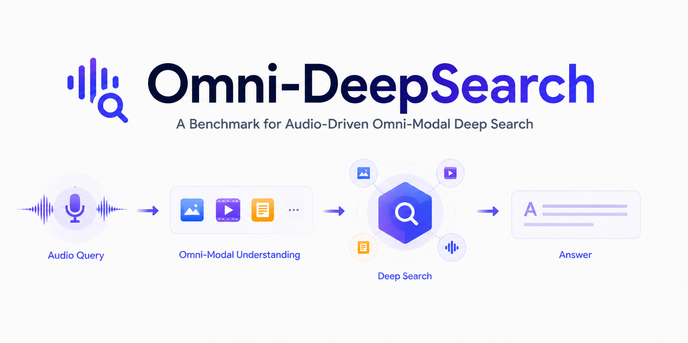
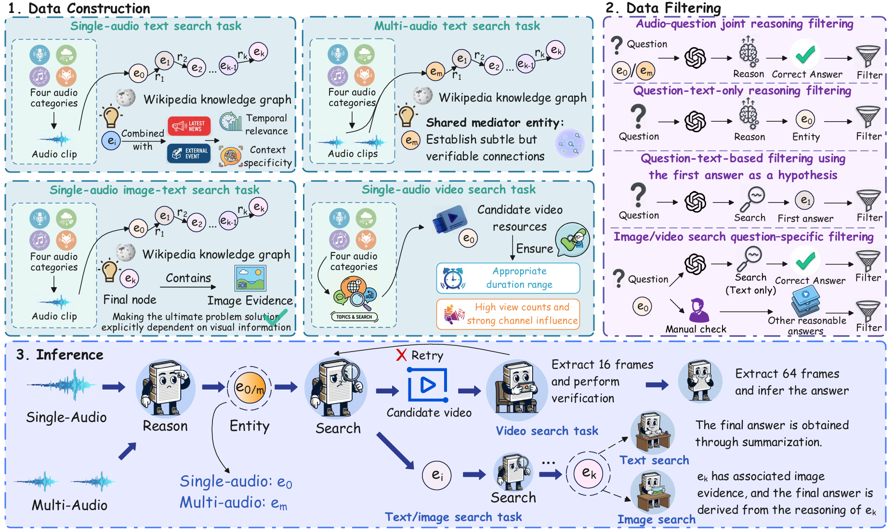

<div align="center">


<br/>

[](https://www.python.org/)
[](https://github.com/yutao1024/Omni-DeepSearch)
[]()
[](https://huggingface.co/datasets/Kirito-Lab/Omni-DeepSearch)

✨ **Focus on Multimodal Audio Deep-Search: Automated generation, filtering, and evaluation of multi-hop reasoning benchmarks** ✨  

| 🧩 **Fully Automated Pipeline** &nbsp;|&nbsp; 🎵 **Rich Audio Domains** &nbsp;|&nbsp; 🧠 **Multi-Hop Reasoning QA** &nbsp;|&nbsp; 🤖 **Agentic Evaluation** |

</div>

## 📑 Table of Contents

<div align='center'>
<font size=4>

[[🔥 News](#-news)]  [[🌈 Overview](#-overview)]   [[🤗 Dataset](#-dataset)]  [[🚀 Quick Start](#-quick-start)]  [[📸 Showcase](#-showcase)]  [[📖 Citation](#-citation)]

</font>
</div>


## 🔥 News

**[202X/0X/0X]** 🚀 Omni-DeepSearch dataset is now officially live on Hugging Face! Click here to explore our [Dataset](https://huggingface.co/datasets/Kirito-Lab/Omni-DeepSearch).

**[202X/0X/0X]** 📄 Omni-DeepSearch is now available on [arXiv]().

## 🌈 Overview    

<div align="center">
  
</div>
<br/>


## 🤗 Dataset

Access the Omni-DeepSearch dataset, featuring complex multi-hop reasoning audio QA pairs, now available on Hugging Face: [Omni-DeepSearch Dataset](https://huggingface.co/datasets/Kirito-Lab/Omni-DeepSearch).

## 🚀 Quick Start

### Prerequisites
Before installation, ensure you have the following system dependencies installed:
- **Python** 3.8+
- **FFmpeg** (for audio extraction and slicing)
- **Node.js** (required by `yt‑dlp`'s JavaScript runtime)

### Installation

#### Clone this repository and navigate to the folder:
```bash
git clone https://github.com/omni-benchmark/omni-bench.git
cd omni-bench
```

#### Create New Environment
To ensure reproducibility and avoid dependency conflicts, we strongly recommend creating a dedicated Python environment for this project.
```bash
# Using venv
python -m venv venv
source venv/bin/activate  # On Windows: venv\Scripts\activate

# Or using Conda
conda create -n omni-bench python=3.10
conda activate omni-bench
```

#### Install Dependencies
Install the required Python dependencies for this project. All dependencies are listed in requirements.txt.
```bash
pip install -r requirements.txt
```

#### Configuration
Edit config/config.yaml with your own API keys, LLM configurations, and paths:
```bash
serper_api_key: "your-serper-key"
jina_api_key: "your-jina-key"

llm:
  qwen:
    api_key: "your-qwen-key"
    base_url: "https://dashscope.aliyuncs.com/compatible-mode/v1"
    model_name: "qwen3.5-omni-plus"
  # Configure other providers (gemini, gpt, claude, etc.) as needed

# Path to a YouTube cookies file (required for downloading videos)
cookies_path: "config/cookies.txt"
```
⚠️ Important: Downloading from YouTube requires a cookies.txt file exported from your browser. Please place it under the config/ directory and ensure the path is correctly set in the YAML file above.

#### Launch Application
All generated data will be automatically placed under the data_workspace/ directory.
##### 1. Acquire Audio
Downloads thematic audio clips from YouTube across SPEECH, MUSIC, BIO, and ENV domains.

```bash
python acquisition_pipeline.py
```
##### 2. Generate Benchmarks
Choose the specific task type you want to generate:
```bash
# Single‑audio and multi‑audio interaction questions
python audio_qa_pipeline.py

# Audio‑to‑image visual reasoning questions
python audio_to_image_pipeline.py

# Audio‑tracing (video source identification) questions
python audio_tracing_pipeline.py
```
Note: Each script creates a timestamped folder inside data_workspace/benchmark_runs/ containing the raw benchmark, filtered versions, and necessity‑verified subsets.
##### 3. Evaluate
After benchmarks are successfully generated, you can evaluate them via the inference pipeline:

```bash
# Standard evaluation
python inference_pipeline.py data_workspace/benchmark_runs/20250301_120000

# Evaluation with a specified output directory
python inference_pipeline.py data_workspace/benchmark_runs/20250301_120000 /path/to/previous/output
```

## 📄 License

[](https://creativecommons.org/licenses/by-nc-sa/4.0/)

This project and dataset are licensed under the **Creative Commons Attribution-NonCommercial-ShareAlike 4.0 International License (CC BY-NC-SA 4.0)**. 

## 📖 Citation
Please kindly cite our paper if you find this project or dataset helpful.
```bash
@misc{omnideepsearch202X,
      title={}, 
      author={},
      year={},
      eprint={},
      archivePrefix={arXiv},
      primaryClass={},
      url={}, 
}
```